<p align="center"></p>
<h1 align="center">Pocket Photos</h1>
<p align="center">The photos of a household in one private place: a library that feels like Apple Photos or Google Photos, albums, people, memories and places, on top of the Immich server you already run — and the pictures sitting in Pocket Files and Pocket Documents, one tap away from the library.<br>One Go binary, one SQLite file, one volume.</p>

Pocket Photos is the everyday face of an [Immich](https://immich.app) server. Immich keeps doing what it is
good at — storing originals, phone backup, face recognition, smart search — and Pocket Photos gives everyone
on the box a calm, fast app in the same design as the other Pocket apps, signed in with Pocket Core. Each
person brings their own Immich library (an API key, a password, or the credentials Core already holds for
them); nobody — admins included — can browse somebody else's. Photos that ended up in a shared folder or
were scanned into the document archive can be picked and copied into the library without touching the
originals.

<p align="center">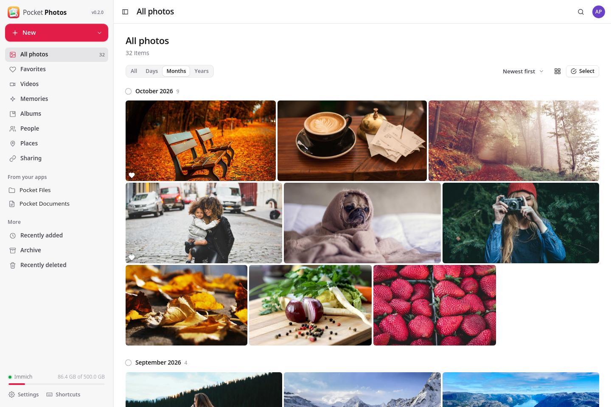</p>

<table>
  <tr>
    <td width="50%">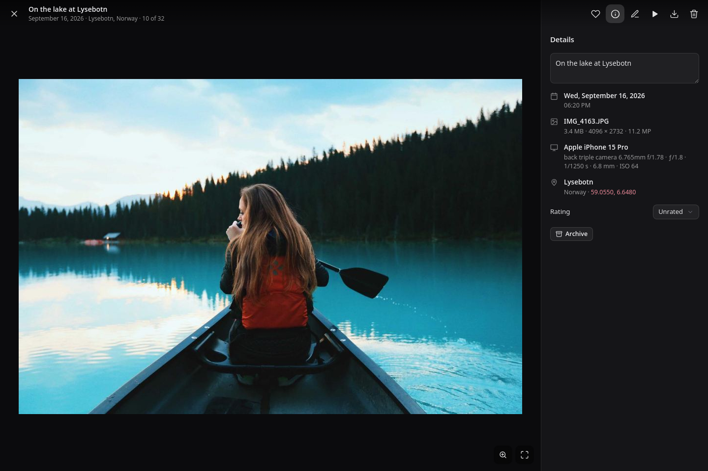</td>
    <td width="50%">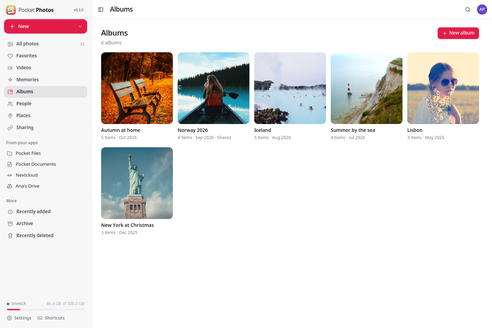</td>
  </tr>
  <tr>
    <td align="center"><sub>Swipe through, read the camera's details, add a description and stars.</sub></td>
    <td align="center"><sub>Albums for the trips and the seasons, shared with a link.</sub></td>
  </tr>
  <tr>
    <td width="50%">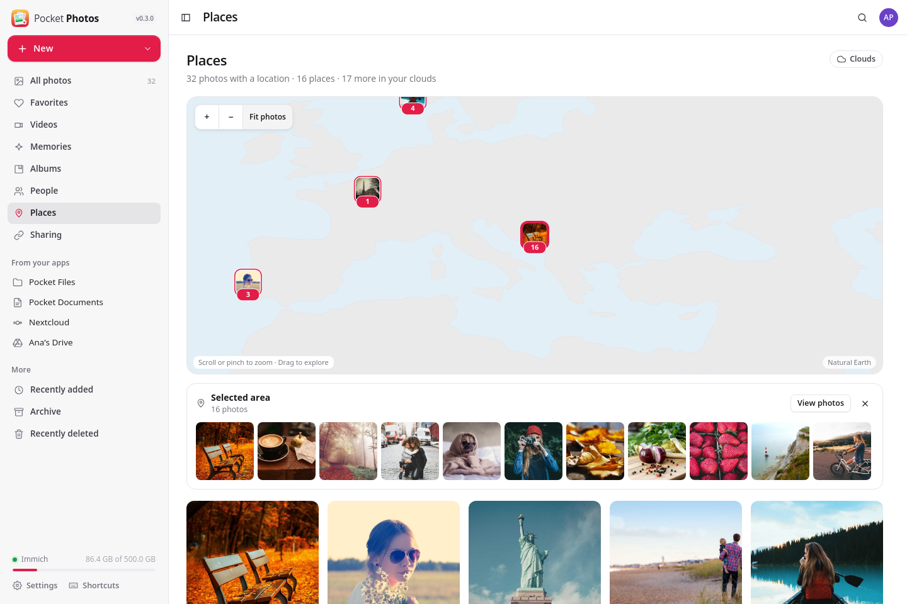</td>
    <td width="50%">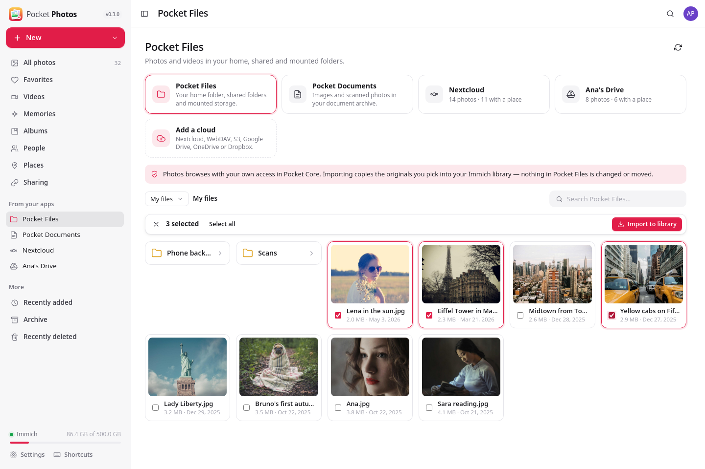</td>
  </tr>
  <tr>
    <td align="center"><sub>Every place on a map that ships with the app — no tiles from anyone.</sub></td>
    <td align="center"><sub>Pick photos in Pocket Files or Pocket Documents; the originals stay put.</sub></td>
  </tr>
  <tr>
    <td width="50%">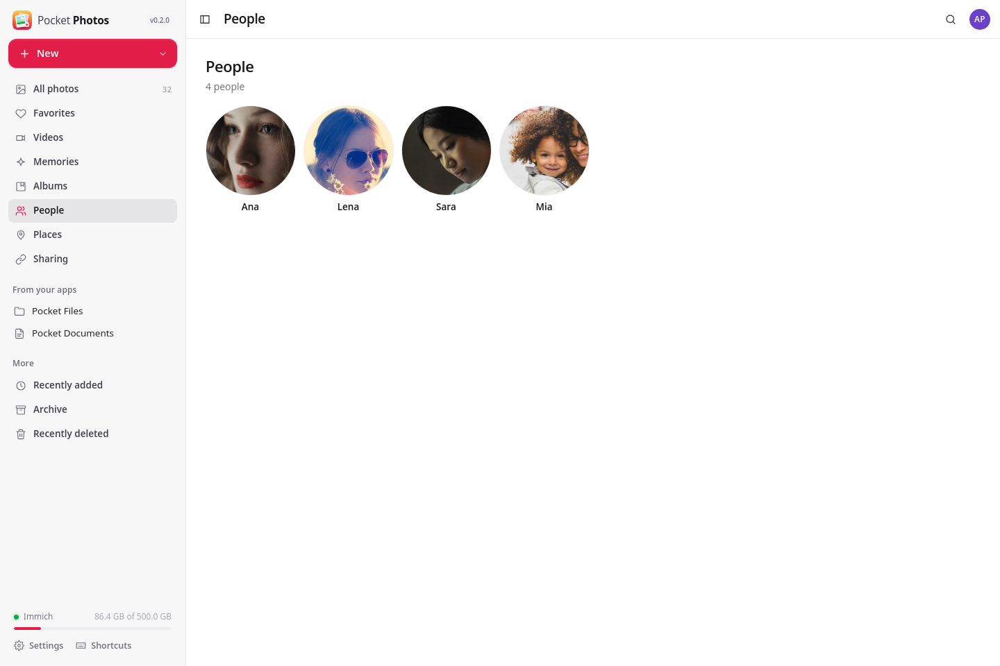</td>
    <td width="50%">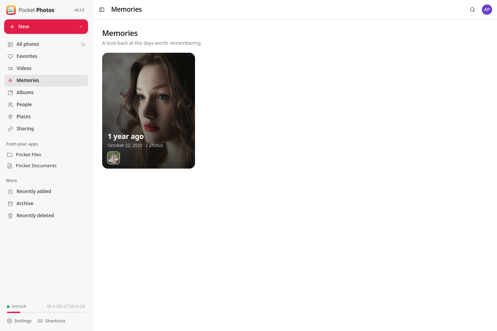</td>
  </tr>
  <tr>
    <td align="center"><sub>People Immich recognised, named in place.</sub></td>
    <td align="center"><sub>On this day, a year ago.</sub></td>
  </tr>
  <tr>
    <td width="50%">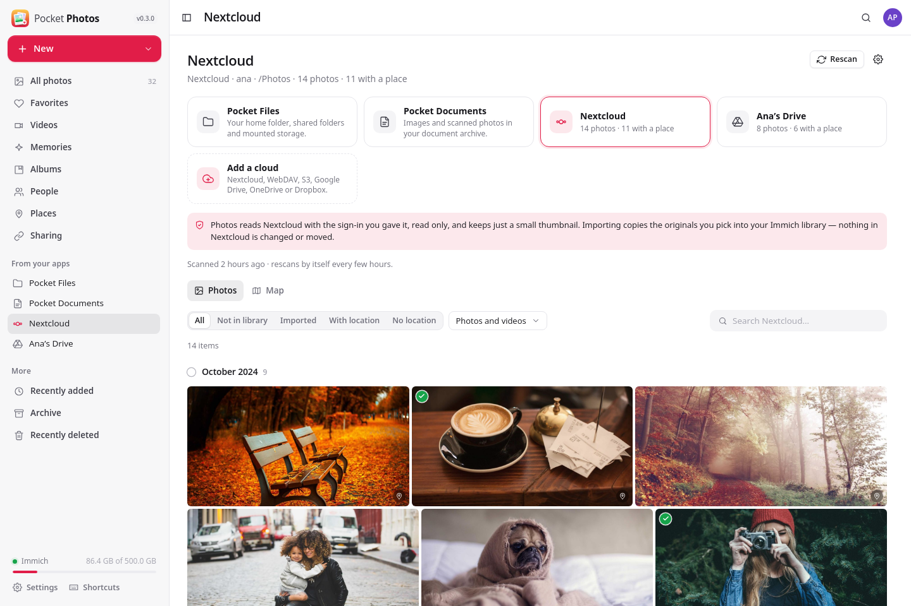</td>
    <td width="50%">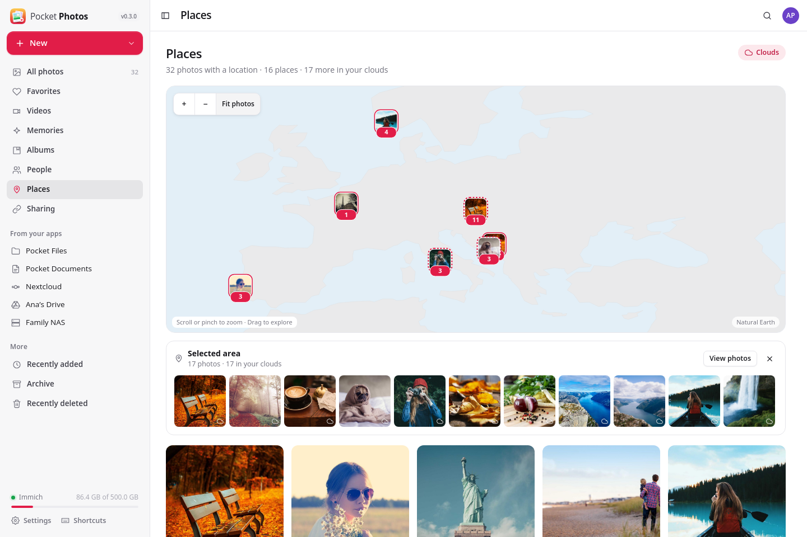</td>
  </tr>
  <tr>
    <td align="center"><sub>Your Nextcloud, Drive or Dropbox photos, reviewed in place.</sub></td>
    <td align="center"><sub>Cloud photos on the same map as your library.</sub></td>
  </tr>
</table>

<p align="center">
  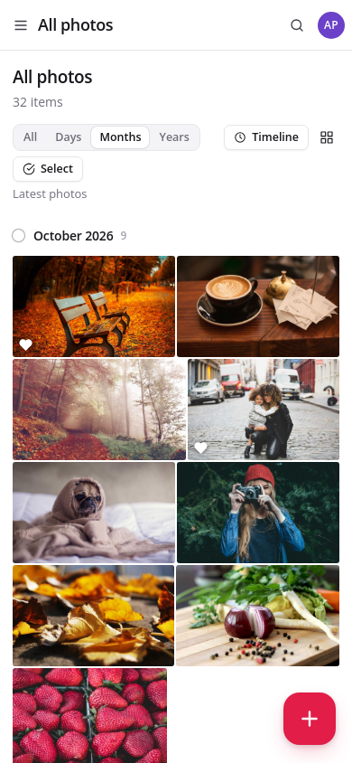&nbsp;&nbsp;
  &nbsp;&nbsp;
  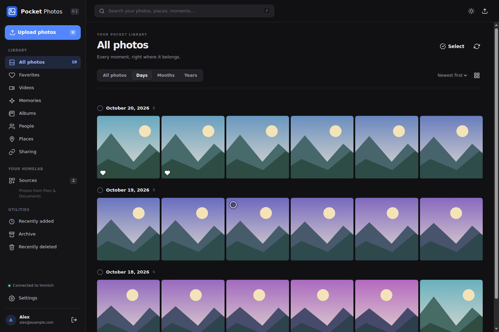
</p>

All screenshots use the fixture library — real photographs from Unsplash, made-up people and trips.
[How to refresh them](docs/screenshots/README.md).

## What it does

**The library**
- Every photo and video grouped by day, month or year, newest or oldest first, a denser or roomier grid,
  endless scrolling; favorites, videos, recently added, archive and recently deleted with restore.
- Search the way Immich searches: in plain words ("dog on the beach"), by file name or by the text in the
  picture, filtered by type and dates.
- A full-screen viewer with swipe and keys, zoom, slideshow, videos and Live Photos, the camera's details and
  a map; descriptions and star ratings; crop, rotate and mirror without losing the original; download.

**Albums, people, memories, places**
- Create, rename and delete albums, add and remove a selection; deleting an album keeps its photos.
- People recognised by Immich, named in place; *On this day* memories; every photo with a location on a world
  map that ships with the app — no map tiles fetched from anyone.
- Sharing links with an expiry, a password, and download and metadata switches; revoke them any time.

**Getting photos in**
- Upload photos and videos by drag and drop with progress, cancel, retry and duplicate reporting; download a
  selection as a zip.
- Browse your home and shared folders in [Pocket Files](https://github.com/abjelosevic88/pocket-homelab-files)
  and the images in [Pocket Documents](https://github.com/abjelosevic88/pocket-homelab-documents), preview
  them and import the ones you pick. The source files stay where they are; Immich spots duplicates.
- Phone camera backup stays with the Immich mobile app, against the same server.

**Clouds — review in place, import what you pick** ([details](docs/clouds.md))
- Connect Nextcloud (through Pocket Core, or directly with an app password), any WebDAV server, an S3 bucket
  (Backblaze B2, Wasabi, MinIO…), Google Drive, OneDrive or Dropbox. Each person connects their own; nobody
  else sees them.
- Photos finds every photo and video there and reads its date, camera and GPS position — from the cloud's
  own metadata, or from the file with a few small range requests, never by copying the library — and keeps
  a thumbnail. Place names come from your Immich, nothing leaves the box.
- Jump through each cloud with the year/month timeline in the sidebar (the **Timeline** button on phones);
  counts follow your search and filters across the full index.
- Browse each cloud by month, filter to what is not in your library yet or has no location, open photos
  full size, see them on the Places map next to your Immich photos, and import the ones you want.
  The clouds are only ever read. New photos are picked up every few hours.

**With the other Pocket apps** (through [Pocket Core](https://github.com/abjelosevic88/pocket-homelab-core))
- Sign in with Pocket Core, and use the Immich credentials Core already keeps for you.
- Uses only `files:read` and `documents:read`; Core decides per person, and the source app checks folder,
  share and document access on every read.

## Ask AI about a photo

Open a photo in the library or a cloud source and click **Ask AI** in the viewer
(the sparkle button on phones). Pocket Ask opens with a preview attached and an
editable question. Try “What does the error in this screenshot mean?”, “Read the
text in this photo”, or “Suggest a caption”. Press **Ask** to send it, then ask
follow-up questions in the same conversation.

Photos must be connected to Core, and Core must share Photos and Pocket AI with
your account. Sign in to Core and enable Pocket Ask when prompted. The model
selector uses the existing Pocket AI service; no separate API key is needed here.

Only after you press Ask does the preview go to Pocket AI and its model provider.
The preview is resized to at most 1,600 pixels on its longest side, so very small
text may not be readable. The original is unchanged, cloud photos do not need
importing, and your cloud credentials are not shared. This action supports photos,
not video analysis. Your questions are saved as private Pocket AI conversations.

## Run it

```sh
docker run -d --name pocket-photos -p 8080:8080 -v ./data:/data \
  -e BASE_URL=https://photos.example.com -e TZ=Europe/Berlin \
  -e IMMICH_URL=http://immich-server:2283 -e IMMICH_PUBLIC_URL=https://immich.example.com \
  ghcr.io/abjelosevic88/pocket-homelab-photos:latest
```

Open it, create the first account (or set `ADMIN_EMAIL` / `ADMIN_PASSWORD`) and connect your Immich library
under **Settings → Your photo library**. See [docker-compose.yml](docker-compose.yml),
[configuration](docs/configuration.md) and the [API](docs/api.md). Put it behind HTTPS and set
`SECURE_COOKIES=true`. `IMMICH_PUBLIC_URL` is where sharing links open, so recipients need to reach it.

On a Pocket Box, set `CORE_URL` and `CORE_REGISTRATION_KEY`: the app registers itself, people sign in with
Pocket Core, and Pocket Files and Pocket Documents appear under *Sources* with nothing to configure — and so
does each person's Nextcloud. Google Drive, OneDrive and Dropbox need your own OAuth client registration
(`GOOGLE_*`, `MICROSOFT_*`, `DROPBOX_*`; the steps are in [Clouds](docs/clouds.md) and in the app).

Immich 3.3 is the tested API target (structured search filters and the non-destructive edits API). Immich
remains the system of record for originals, albums, faces, sharing and trash — back it up on its own.
Pocket Photos' `./data` holds only accounts and each person's sealed Immich connection;
`pocket-photos backup` writes a consistent copy of the database.

## Build

```sh
make web build      # React UI into web/dist, then the Go binary that embeds it
make run            # no login, on :8080, against IMMICH_URL (default http://localhost:2283)
make test           # Go tests + type-check the UI
make e2e            # browser suite + screenshots against the fixture library (no Immich needed)
```

Go 1.26, Node 22. Stack: Go (chi, modernc SQLite), React 19 + Vite. Install FFmpeg on PATH for cloud video thumbnails when the provider has no preview; the Docker image includes it.
The fixture library is real photography from Unsplash — [credits](scripts/fixtures/README.md) and
[attribution](docs/attribution.md).

## License

MIT
